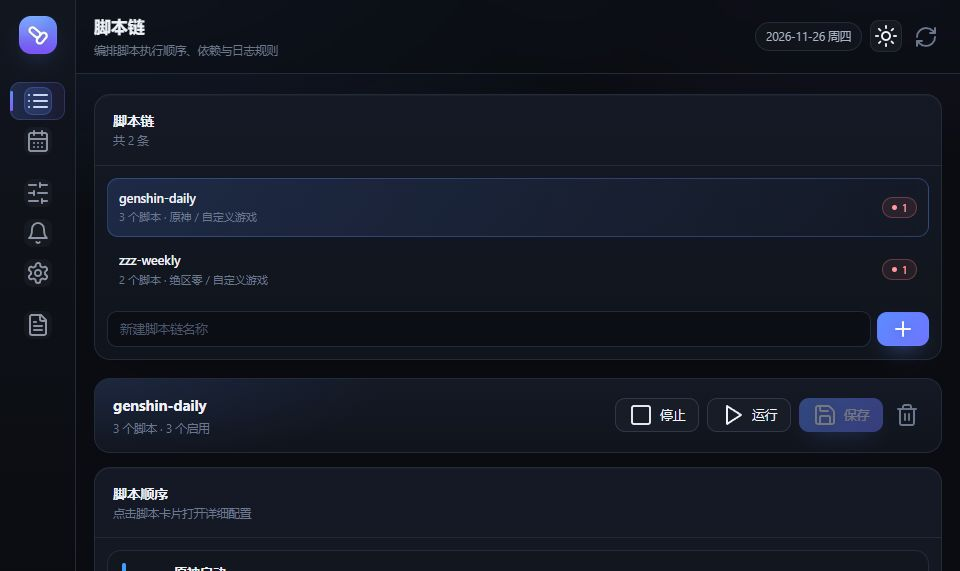
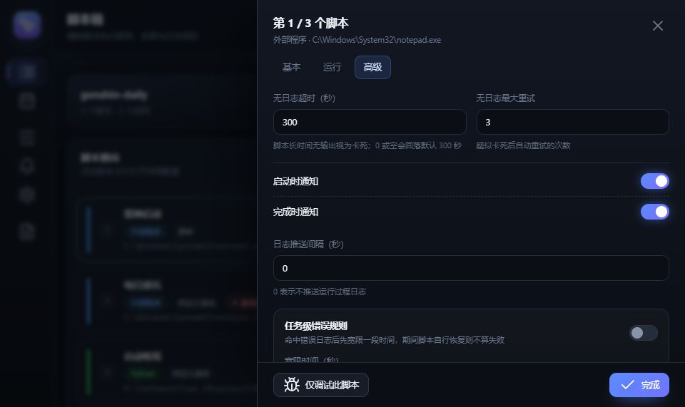
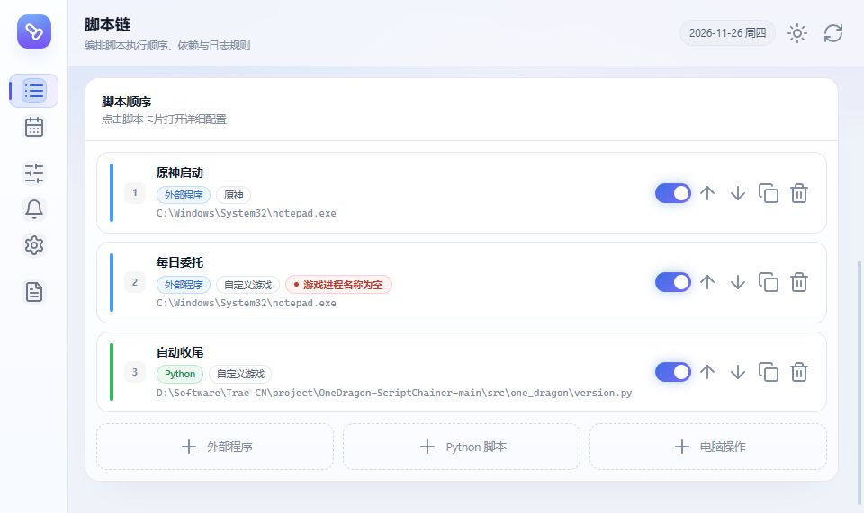

<div align="center">



# OneDragon ScriptChainer Plus

简易的脚本链式调用工具 · 千机链增强版

当前版本 **0.1.0**

</div>

---

OneDragon ScriptChainer Plus 是基于 OneDragon 框架的脚本链工具：把多个游戏日常、外部程序和 Python 脚本编排成一条链，按顺序执行、统一调度，并输出可追溯的运行结果。本仓库是面向自用与社区维护的增强版，重点在 Web 可视化管理、配置项完整开放和运行可靠性。

## ✨ 特性

- 🤖 **脚本链编排**：创建多条脚本链，按顺序调用脚本，可拖动排序、单独禁用、单独调试
- 🧩 **多类型脚本**：支持启动外部程序、新建/导入 Python 脚本、执行电脑操作（隐私屏开关）
- 🔗 **前后置挂靠**：Python 脚本可挂靠到相邻脚本前后，用于准备与收尾
- 🖥️ **全新 Web 界面**：FastAPI + React + pywebview，深色 / 浅色主题一键切换，设置自动记忆
- 🎛️ **配置全量可视化**：启动器模式、实际运行进程、进程树清理、超时、日志推送、错误规则、卡死检测等均可在界面设置
- 📁 **原生文件选择**：脚本路径旁提供「选择文件」，直接调起 Windows 文件对话框
- ⏰ **内置常驻调度**：按周计划在时间窗内自动运行，支持每日一次、中断补跑、自动关机、开机自启，无需 Windows 计划任务
- 🛡️ **运行可靠性**：锁屏检测、全局截止、无日志超时、失败脚本重跑、任务级错误规则与打转检测、运行期保持唤醒
- 📊 **结构化运行结果**：每个脚本输出一条 JSON 事件，链结束生成 JSON / 文本报告
- 📣 **消息推送**：脚本开始、结束、失败即时推送，可定时推送运行日志
- 📦 **单程序交付**：GUI 与脚本执行器合并为一个 exe，升级时自动清理旧版残留文件

## 📸 界面预览

| 深色主界面 | 脚本配置抽屉 |
| --- | --- |
|  |  |

浅色主题：



## 🚀 快速开始

1. 前往 [Releases](https://github.com/authortwo/OneDragon-ScriptChainer-Plus/releases) 下载 `OneDragon-ScriptChainer-Plus-<版本>.zip`
2. 解压到任意目录，双击 `OneDragon ScriptChainer Plus.exe` 打开界面
3. 在「脚本链」页新建脚本链，添加脚本并保存，点击「运行」即可

> `OneDragon ScriptChainer Plus.exe` 依赖同目录的 `.runtime` 文件夹，请勿单独移动 exe。手动升级时先删除旧版 `.runtime` 再解压覆盖；也可以在「设置」页直接检查更新。

命令行运行：

```powershell
# 运行指定脚本链
"OneDragon ScriptChainer Plus.exe" -o --chain 01

# 运行后 60 秒关机
"OneDragon ScriptChainer Plus.exe" -o --chain 01 -s 60
```

## 🖥️ 界面

| 页面 | 能力 |
| --- | --- |
| 脚本链 | 新建/删除链，增删脚本、排序、启用开关；编辑路径、游戏进程、完成判定、超时、启动器模式、日志规则等 |
| 周计划 | 周一到周日 + 默认列表多选，保存后写入 `config/run.yml` 的 `schedule` |
| 运行策略 | 时间窗、全局截止、轮询间隔、每日一次、锁屏处理、重试、保持唤醒、关机、账户校验、开机自启 |
| 消息推送 | 通知标题与总开关、启动前通知、附带截图、网络代理；24 个推送渠道（企业微信、钉钉、飞书、SMTP、Webhook 等）可视化配置、单独测试与全部测试 |
| 日志规则 | 内置 BetterGI（原神）、MAA（崩坏3）、绝区零一条龙三套规则集，可加载自定义 `.yml`；对真实日志试跑看每条规则的命中与样例，判定卡死打转（同行高频重复 + 段内原地轮转），再一键写入脚本配置，两者都能参与运行时终止 |
| 设置 | 代码源与资源下载源、检查更新、运行环境信息 |
| 运行报告 | 最近一次运行的汇总、脚本明细、文本报告与日志尾部 |

界面启动时会以管理员权限运行；UAC 确认被取消时退出码为 6。

## ⏰ 常驻调度与运行策略

核心配置写在 `config/run.yml`：

```yaml
scheduler_enabled: true      # 是否启用常驻调度
scheduler_poll_seconds: 30   # 轮询间隔（秒）
once_per_day: true           # 当日只跑一次；中断后自动补跑
autostart_enabled: false     # 随系统登录自动启动常驻调度
deadline_minutes: 210        # 全局截止时间（分钟），0 表示不限
on_locked: abort             # abort 跳过 / reboot 重启一次 / wait 等待解锁
shutdown_after_run: 0        # 计划跑完后自动关机；0 表示不关机，60 表示 60 秒后关机
retry:
  max_rounds: 2              # 最多重跑轮数，0 表示不重跑
  delay_seconds: 60          # 每轮开始前等待时间
  only_failed: true          # 只重跑失败脚本
  skip_on_config_error: true # 配置错误不重跑
  skip_on_crash: true        # 环境故障/启动即崩不重跑
run_window:
  start: "04:15"             # 允许运行的时间窗，两端留空表示不限
  end: "06:15"
keep_awake: true             # 运行期阻止系统睡眠和熄屏
run_as_sid: ""               # 期望运行账户的 SID，留空不校验
run_as_sid_action: abort     # 账户不匹配时 abort（退出码 2）/ warn
schedule:                    # 星期 -> 脚本链列表
  monday: [genshin-daily]
  default: [genshin-daily, zzz-weekly]
```

- 每天优先使用当天星期对应的列表，没有配置时回退到 `default`。
- 时间窗与全局截止同时生效，取两者较早的时间收尾。
- 启动脚本前检测锁屏，锁屏时不会启动任何脚本。
- 当日状态记录在 `config/state/daily_run.yml`，断电或强杀后会自动判定为中断并补跑。

## 🛑 失败判定与重跑

脚本级规则写在 `config/script_chain/*.yml` 的脚本项里，可按脚本单独配置：

```yaml
fail_fast:                    # 任务级错误识别
  enabled: true
  action: report              # report 只登记继续跑（默认）；stop_task 终止当前脚本
  grace_seconds: 240          # 命中后宽限时间，期间自行恢复则不算失败
  error_patterns:
    - "\\[ERROR\\]\\[task_flow\\.py\\]"
    - "任务 '[^']{1,40}' 执行失败"
  ignore_patterns: ["DEBUG"]
stall:                        # 卡死 / 原地打转检测
  enabled: true
  window_minutes: 8
  min_repeats: 200
  ignore_pattern: "DEBUG"
  ignore_levels: ["DBG", "TRC"]   # 这些级别的刷屏不计入重复
  grace_seconds: 60
loop:                         # 段内原地轮转（可选）
  runtime: true               # 显式开启才参与运行时终止
  segment_start: "task start:"
  segment_end: "task end:"
  step_pattern: 'name":"([^"]+)"'
  min_iterations: 200
  max_progress: 8
  same_state_repeats: 90
no_log_timeout_seconds: 300   # 无日志超时（不允许关闭，0 回落 300）
no_log_max_retries: 3         # 无日志超时后的重试次数
```

`action: report` 时命中只登记、脚本继续跑，登记项写进运行报告；`stop_task` 才会终止脚本。
打转（stall / loop）命中后同样先等宽限期，仍未恢复才终止。整链结束后按 `retry` 配置只重跑失败的脚本。

规则也可以不碰 YAML：脚本「高级」页有「规则来源」下拉，选一套规则集一键填入，再按需改阈值或动作。

## 📊 运行报告

- 事件流：`config/state/run-events.jsonl`，每行一个 JSON
- 汇总报告：`config/state/last-report.json`（可用 `--report-json` 指定）
- 文本报告：`config/state/last-report.txt`，首行即结论，适合直接推送
- 周计划汇总：`config/state/last-plan.json` / `last-plan.txt`

每个脚本结束时输出的事件示例：

```json
{"ts":"2026-11-25T05:03:59","event":"script_end","chain":"genshin-daily",
 "index":0,"display_name":"原神启动","script_path":"...YuanShen.exe",
 "verdict":"fail","end_reason":"timeout","retry_round":1}
```

`verdict` 取值：`ok` / `fail` / `config_error` / `env_error` / `missing`。

## ⌨️ 命令行参数

| 参数 | 说明 |
| --- | --- |
| `--onedragon` / `-o` | 跳过 GUI 直接执行脚本链 |
| `--chain <名称>` | 指定脚本链，默认 `01` |
| `--debug-index <下标>` | 只调试指定脚本，并按挂靠关系一并编排 |
| `--shutdown [秒]` / `-s` | 运行后关机，默认延迟 60 秒 |
| `--daemon` | 启动常驻调度（单实例） |
| `--plan` | 按今日计划执行一次后退出 |
| `--run-now` | 立即补跑今日计划，忽略时间窗与每日一次 |
| `--wait` | 已有实例在运行时，等待其退出后接管 |
| `--fail-fast` | 已有实例在运行时立即退出并打印持有者 PID |
| `--replay <日志>` | 离线回放历史日志，用同一套规则重新判定 |
| `--autostart on\|off` | 开启 / 关闭开机自启 |
| `--version` | 显示版本号 |

退出码：

| 退出码 | 含义 |
| --- | --- |
| 0 | 全部成功 |
| 1 | 存在失败脚本 |
| 2 | 配置错误 |
| 3 | 到达全局截止时间 |
| 4 | 锁屏阻断 |
| 5 | 已有运行实例，本次未启动 |
| 6 | 提权失败（UAC 被取消） |

## 🧑‍💻 从源码运行

需要 Python 3.11：

```bash
pip install -e .

# 桌面窗口
python -m script_chainer.webui.app

# 无 WebView2 的环境：用系统浏览器
python -m script_chainer.webui.app --browser
```

构建单程序（在 `deploy` 目录下）：

```powershell
pyinstaller "OneDragon ScriptChainer Plus.spec"
```

产物位于 `deploy/dist/OneDragon ScriptChainer Plus/`。

## ⬆️ 从旧版本升级

- 旧版分发的 `OneDragon ScriptChainer Runner.exe` 已合并进主程序，不再单独提供。
- 覆盖升级时会自动清理旧目录中的 Runner 与旧文件名。
- 手动升级请先删除 `.runtime` 文件夹再解压，避免旧运行时残留。

## 🙏 致谢

本项目基于 [OneDragon](https://github.com/OneDragon-Anything) 框架，并由上游 OneDragon-ScriptChainer 改造而来，原项目版权归其作者所有。使用与分发请遵循原项目的许可协议。
